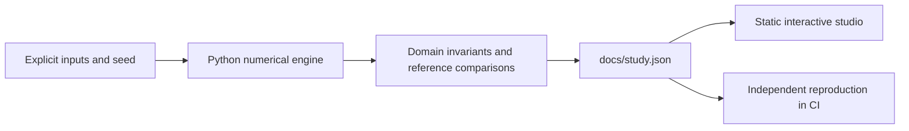

# Quantum Risk Observatory

From a correlated derivatives book to the quantum estimation oracle.

**[Open the interactive research studio](https://fyodoramanov1.github.io/quantum-estimation-lab/)** · [Measured study](docs/study.json) · [Technical case study](reports/applied-study.md) · [Source](src/studio.py)

Build a defensible derivatives-risk research application connecting classical scenario methods to explicit quantum estimation costs.

## What you can do

- **Base market:** Four correlated option positions. Revalue the full book at a 21-day horizon and compare three simulation designs at matched path budgets.
- **Volatility shock:** Four correlated option positions. Revalue the full book at a 21-day horizon and compare three simulation designs at matched path budgets.
- **Quantum oracle:** An eight-scenario register and a payoff ancilla, explicit unitary preparation, amplitude amplification and maximum-likelihood estimation.

The interface selects recorded experiments, toggles chart series and exports the comparison table. Each view includes the method, assumptions, provenance and its reproduce command. No API key is required. Market Replay additionally plays the actual book snapshots; the Evidence Observatory performs local retrieval and numeric-claim checks.

## Reproduce

Python 3.12; CPU only. From this repository:

```powershell
python -m pip install -r requirements.txt
python src/studio.py --out docs/study.json
python -m http.server 8000 --directory docs
```

Open `http://localhost:8000`. The static app fetches its local JSON, so use HTTP rather than opening `index.html` directly. No JavaScript build step or package installation is needed.

CI reproduces every applied case with `python src/studio.py --check docs/study.json`, checks numerical invariants and retains the original independent numerical contract. New applied code lives under `src/`; `lab.py` and its original CLI remain compatible for the existing research milestones.

## Recorded findings

### Base market

- 99% value at risk: **683.882 USD**
- 99% expected shortfall: **764.175 USD**
- 99% potential exposure: **1541.6 USD**
- Scenarios: **32768 paths**

### Volatility shock

- 99% value at risk: **1118.24 USD**
- 99% expected shortfall: **1236.2 USD**
- 99% potential exposure: **2617.16 USD**
- Scenarios: **32768 paths**

### Quantum oracle

- Exact encoded expectation: **0.2495 **
- Estimated expectation: **0.25018 **
- Oracle preparation calls: **8960 **
- Logical qubits: **4 **

## Design



`src/common.py` defines the compact study schema and tolerant cross-platform reproduction check (relative tolerance 2e-4, absolute 2e-6). Domain checks use tighter tolerances where appropriate. `quality/contract.py` is a committed independent contract snapshot, protected from the daily generator; public CI does not need access to a private controller.

## Scientific boundaries

New implementation inspired by the application scope of QStockPrediction. Synthetic market parameters; exact CPU statevector experiments. No cloud hardware or API calls.

- Illustrative synthetic asset parameters, not calibrated market data or an investment recommendation.
- Lognormal dynamics omit stochastic volatility, defaults, liquidity and funding; tail estimates remain model dependent.
- The chart compares mean-loss error. It does not establish quantum advantage or tail-quantile confidence intervals.
- Dense unitary simulation is exponential and is not a compiled fault-tolerant implementation.
- This bounded discrete payoff is separate from the portfolio's unbounded continuous loss; no claim that the oracle directly estimates its VaR is made.
- State preparation, inverse preparation and Grover queries are counted. Device gates, errors, compilation and classical inference costs are not hidden in a speedup claim.

## Next research questions

- Calibrate multi-asset scenarios from a user-supplied price CSV and compare model risk under non-Gaussian returns.
- Map a bounded positive-exposure payoff into the oracle and separate discretization, truncation and estimation errors.
- Measure amplitude-estimator bias and interval coverage across independent trials, including boundary probabilities.

## References

- [Original portfolio PFE project](https://github.com/FyodorAmanov1/QStockPrediction)
- [Amplitude amplification and estimation](https://arxiv.org/abs/quant-ph/0005055)

## Development history

AI-assisted implementation. The original baseline and milestone reports are preserved under `reports/`; the applied study is a separate artifact. Results are measured simulations, not claims of live profitability, quantum advantage or independent research novelty. MIT license.
